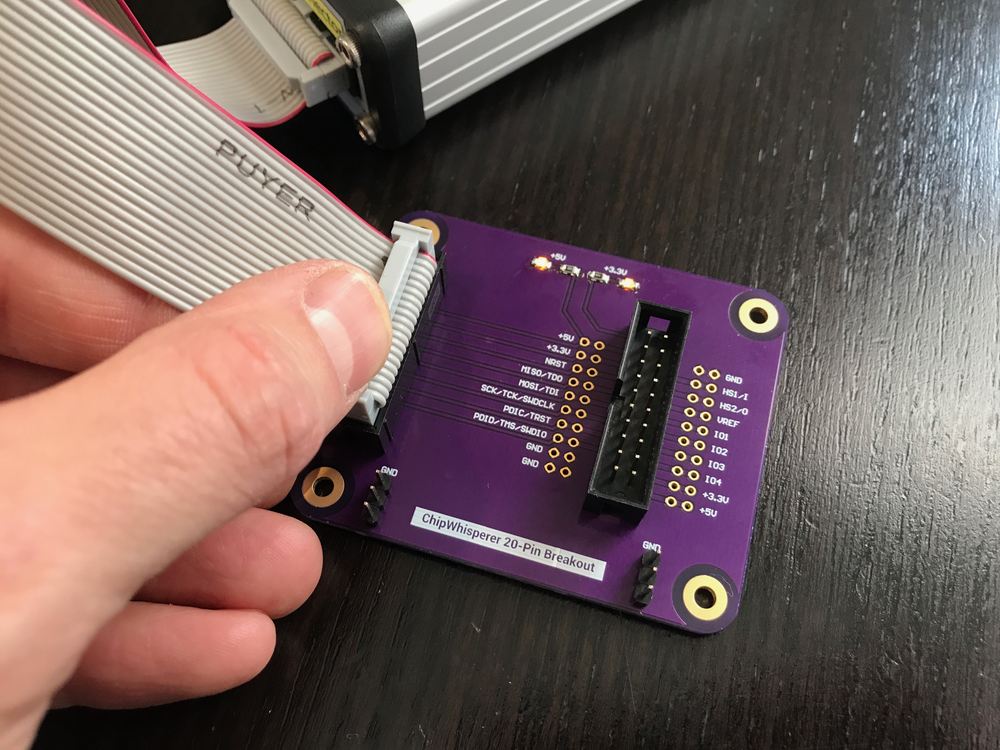

# ChipWhisperer Breakout Board

Designed by [Joe Grand](https://joegrand.com) and [Lennert Wouters](https://x.com/lennertwo)

Minimalist 20-pin breakout/expansion board for [ChipWhisperer](https://www.newae.com/chipwhisperer)

Bare boards available through [OSH Park](https://oshpark.com/shared_projects/pJ6b7VAZ)

Distributed under a [Creative Commons Attribution 4.0 International](https://creativecommons.org/licenses/by/4.0/) license

