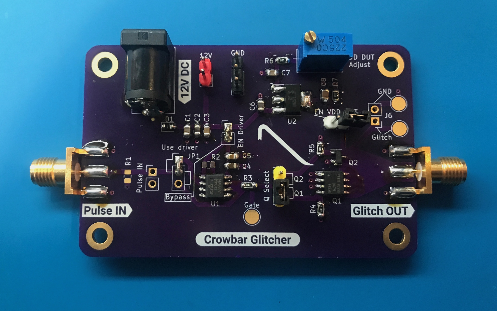

# Crowbar Glitcher

Designed by [Joe Grand](https://joegrand.com) and [Lennert Wouters](https://x.com/lennertwo)

Fault injection/glitching board with two different MOSFETs (IRF8736T and DMG2302UK). 

A front-end MOSFET driver circuit is used to drive the gates of the N-channel MOSFETs. The board also includes an on-board adjustable LDO linear regulator that can be used to power the target board.

Known issue: If you want to drive the MOSFETs (Q1 or Q2) directly, the MOSFET driver circuitry needs to be disabled. The intended method of setting JP1 to Bypass and removing the EN Driver jumper does not work and causes undesirable loading. To completely isolate the MOSFET driver circuitry, you can drive Q1 and Q2 directly from the Q Select jumper pins 1 or 3. Or, to use the SMA Pulse IN connector, remove R3, connect JP1 pin 2 to JP3 pin 2, and then select the desired MOSFET accordingly using the JP3 jumper.	 

Bare boards available through [OSH Park](https://oshpark.com/shared_projects/ijuNYtEx)

Distributed under a [Creative Commons Attribution 4.0 International](https://creativecommons.org/licenses/by/4.0/) license

