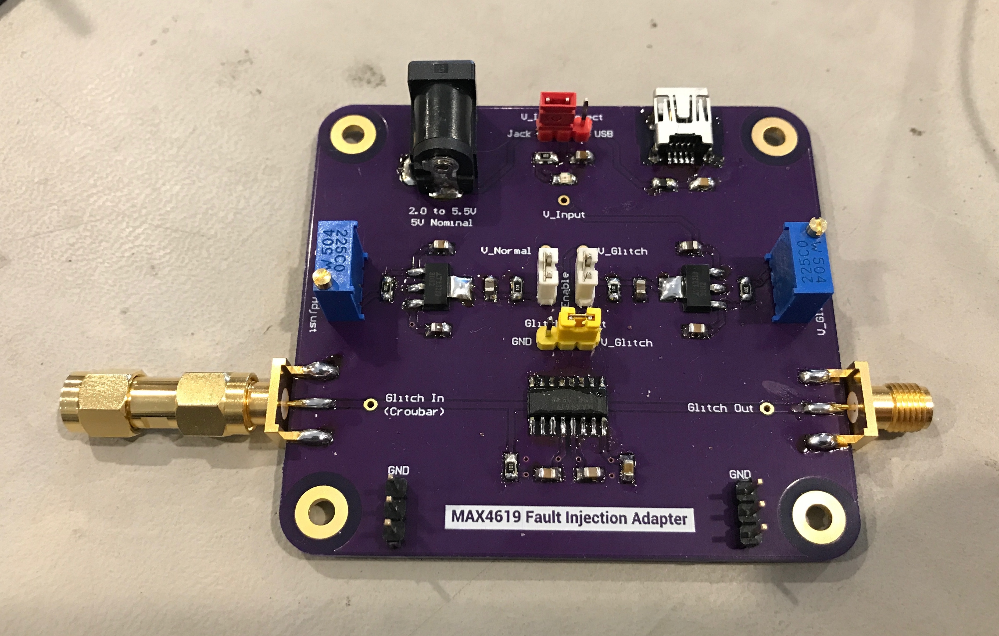
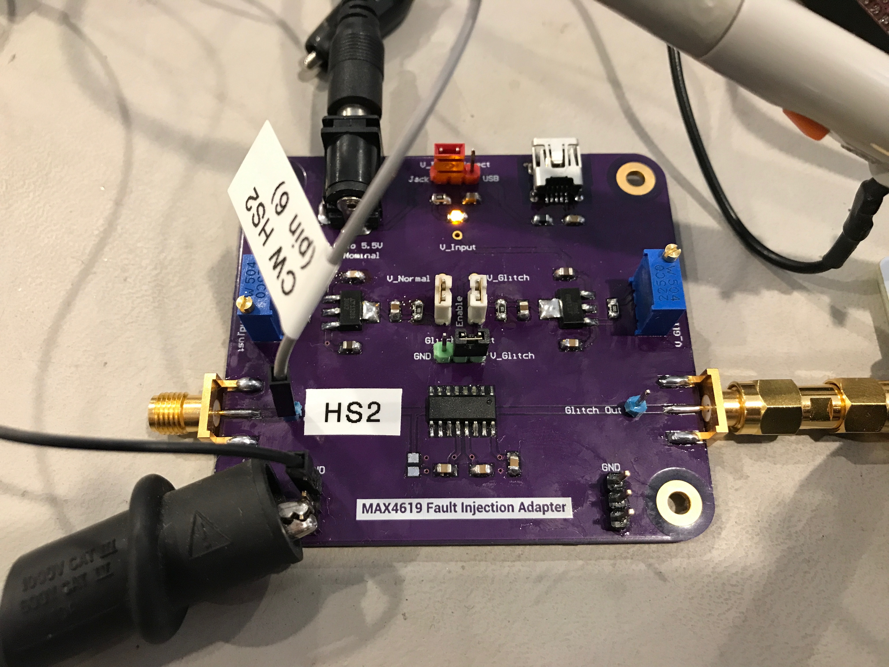

# MAX4619 Fault Injection Adapter

Designed by [Joe Grand](https://joegrand.com) and [Lennert Wouters](https://x.com/lennertwo)

[MAX4619 Analog Multiplexer/Switch](https://www.analog.com/en/products/max4619.html) board intended for use with fault injection. The board allows selection of the normal/non-glitch voltage (V_normal) and desired glitch voltage level (V_glitch) using potentiometers.

The default configuration expects a crowbar output (active low) on the Glitch In SMA connector or test point. In order to use a logic level signal (active high) to enable the switch, remove R4 and swap the values of V_normal and V_glitch. 

Note: This design uses a single channel of the MAX4619. A future enhancement could be to wire multiple MAX4619 channels in parallel, which would allow stronger current sourcing capabilities. 

Bare boards available through [OSH Park](https://oshpark.com/shared_projects/OLXOUpOH)

Distributed under a [Creative Commons Attribution 4.0 International](https://creativecommons.org/licenses/by/4.0/) license

