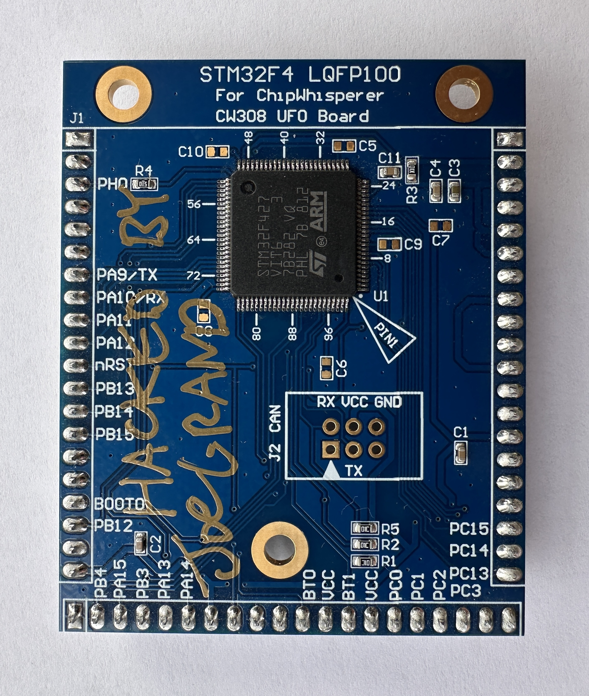

# STM32F4 LQFP100 UFO Target Board

Designed by [Joe Grand](https://joegrand.com) and [Lennert Wouters](https://x.com/lennertwo)

STM32F4 LQFP100 target board for use with the [ChipWhisperer CW308 UFO Baseboard](https://chipwhisperer.readthedocs.io/en/latest/Targets/CW308%20UFO.html)

Bare boards available through [OSH Park](https://oshpark.com/shared_projects/nwemk08k)

Distributed under a [Creative Commons Attribution 4.0 International](https://creativecommons.org/licenses/by/4.0/) license

