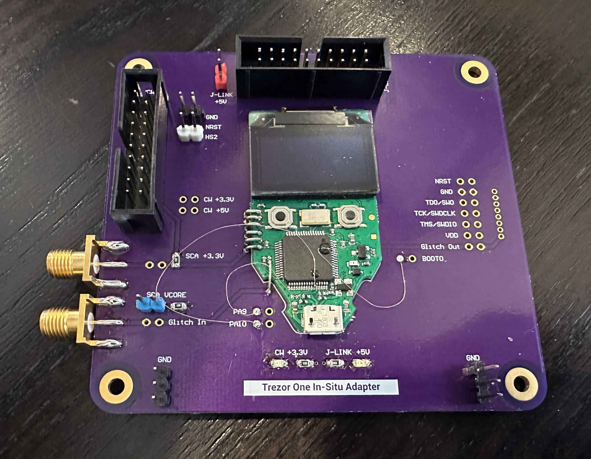

# Trezor One In-Situ Adapter

Designed by [Joe Grand](https://joegrand.com) and [Lennert Wouters](https://x.com/lennertwo)

Adapter board for experimenting with the [Trezor One](https://trezor.io/trezor-model-one) and associated STM32F205 in-situ. Allows for easier connections to the JTAG/SWD interface, [ChipWhisperer](https://www.newae.com/chipwhisperer) 20-pin interface, and SMA connectors (for voltage-based fault injection).

Bare boards available through [OSH Park](https://oshpark.com/shared_projects/c6RrNzx2)

Distributed under a [Creative Commons Attribution 4.0 International](https://creativecommons.org/licenses/by/4.0/) license

